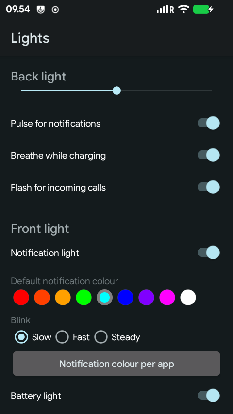
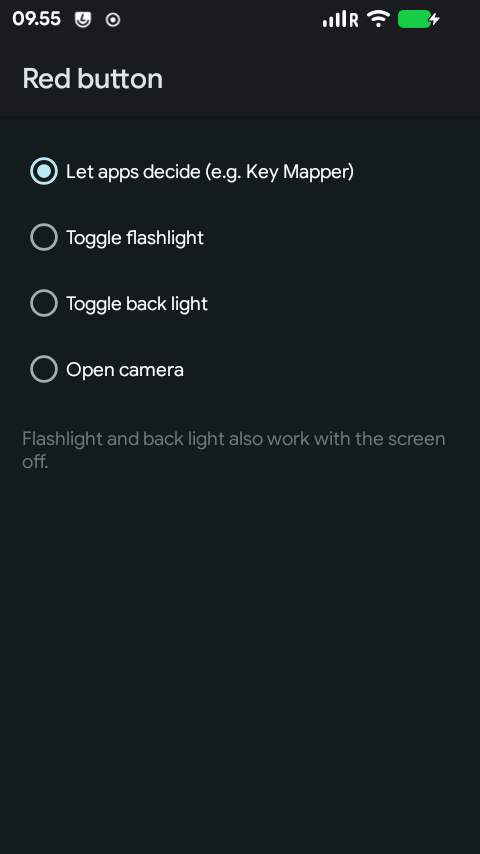
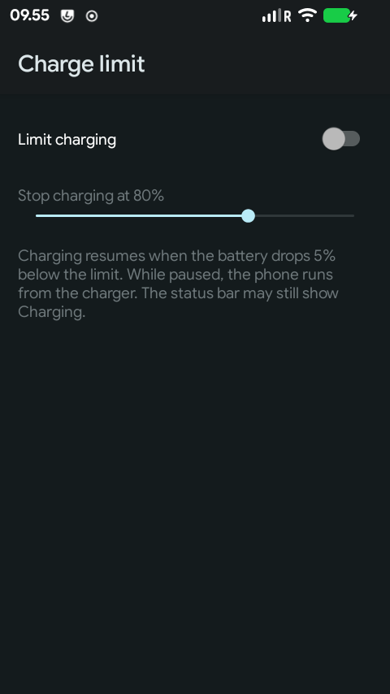
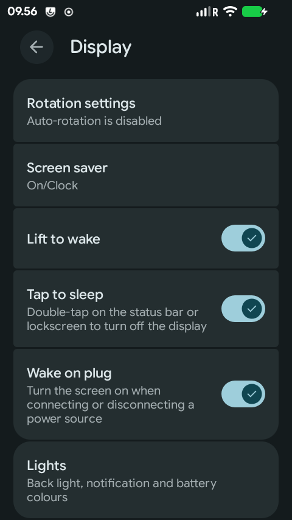
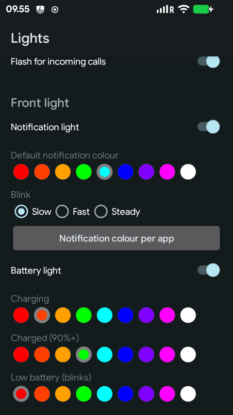
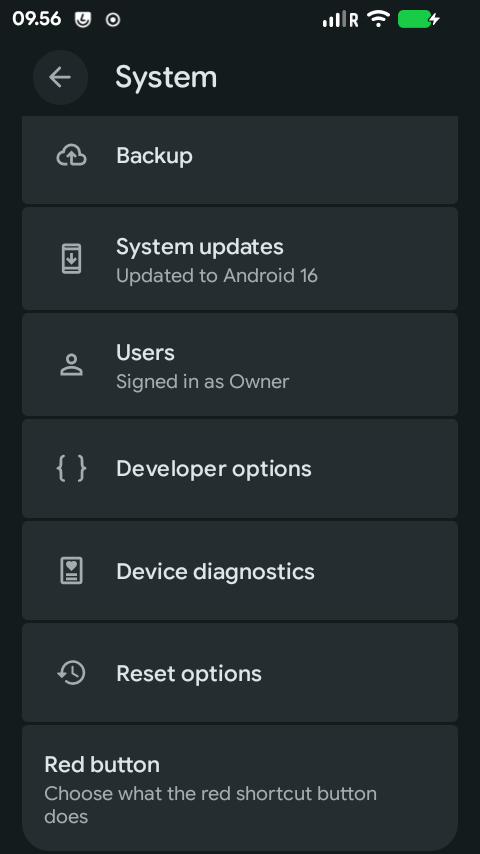
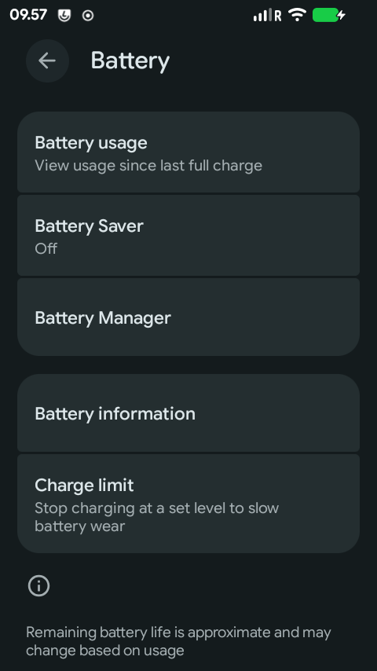

<div align="center">

# LineageOS for the Unihertz Jelly Star

**Unofficial LineageOS 23.2 (Android 16) for the 3" Unihertz Jelly Star.**<br>
A daily-driver phone without Google's or Unihertz's preinstalled apps.

[](https://github.com/osquera/lineageos_unihertz_jellystar/releases/latest)


[](LICENSE)
[](https://github.com/osquera/lineageos_unihertz_jellystar/releases)

**[⬇ Download](https://github.com/osquera/lineageos_unihertz_jellystar/releases/latest)** ·
[Install guide](#installing) ·
[What works](STATUS.md) ·
[Jelly Star settings](#jelly-star-settings) ·
[Updating](#updating) ·
[Unbrick / back to stock](#going-back-to-stock--unbricking)

&nbsp;
&nbsp;


</div>

## Highlights

| ✅ Works | ❌ Doesn't work |
|---|---|
| Calls, SMS, 4G data, **VoLTE** (if your carrier allows it), hotspot | Play Integrity: some banking and payment apps, Google Wallet tap-to-pay |
| Wi-Fi, Bluetooth audio incl. aptX, NFC (reading and as a card), GPS | Wi-Fi calling and video calling (not yet) |
| Fingerprint, both cameras, IR blaster, all sensors | Face unlock |
| Front RGB LED and back LED effects, red button actions, charge limit | |
| Encryption, SELinux enforcing, OTA updates via the Updater app | |

The full list, including what's still untested, is in [STATUS.md](STATUS.md).

## Installing

> [!WARNING]
> - **Installing wipes the phone.** Back up everything first.
> - **Your phone must be running stock Android 16 firmware first** (see *What you need*). The
>   install does not update the phone's first boot stage (the preloader), so installing on top
>   of Android 13 firmware, or a GSI running on it, can leave the phone unable to boot.
> - **The bootloader must stay unlocked**, so Play Integrity fails (not even Basic): apps
>   that require it, like some banking and payment apps and Google Wallet tap-to-pay, will not
>   work. This build does not spoof attestation.
> - **Never relock the bootloader with LineageOS installed.** The bootloader only trusts
>   Unihertz's signing key and has no way to add your own (no `avb_custom_key` as on
>   Pixels), so a relocked phone refuses to boot, and unlocking again needs a booting Android.
> - You do this at your own risk. The release contains Unihertz's stock vendor images and
>   firmware, which are not open source.

### What you need

- A Unihertz Jelly Star on **stock Android 16 firmware, V01.00.04 or later**. EEA and non-EEA
  phones both work: the firmware is the same software for both regions (the build was tested on
  an EEA phone). Check *Settings > About phone > Build number*, which should read like
  `Jelly Star_EEA_V01.00.04`. If you're on an older stock version, update with the stock system
  updater. If you're on a GSI, Android 13, or aren't sure, flash stock Android 16 with SP Flash
  Tool first ([see below](#going-back-to-stock--unbricking)), boot it once, then start here.
- A computer with [Android platform-tools](https://developer.android.com/tools/releases/platform-tools)
  (`adb` and `fastboot`) and a USB-C data cable.
- From the [latest release](https://github.com/osquera/lineageos_unihertz_jellystar/releases/latest):
  `boot.img`, `vendor_boot.img`, `dtbo.img`, `vbmeta.img`, the
  `lineage-23.2-*-UNOFFICIAL-jellystar-signed.zip` and `SHA256SUMS`. Check the downloads:
  ```sh
  sha256sum -c SHA256SUMS
  ```
- Recommended: Unihertz's stock Android 16 firmware for your region, for going back
  ([EEA](https://drive.google.com/drive/folders/1Tqz0NYr2a9XLjOBRl-tcZYJKMoDMSjuE) or [non-EEA](https://drive.google.com/drive/folders/1lbFlSkkFQlNyOaGL8HdICZ0pH1tgte79)).

### Steps

1. **Enable developer options.** Settings > About phone > tap *Build number* seven times.
   Then in Settings > System > Developer options, turn on **OEM unlocking** and
   **USB debugging**. (If the bootloader is already unlocked, *OEM unlocking* is greyed out
   with "Bootloader is already open"; that's fine.)
2. **Unlock the bootloader** (this wipes the phone). Connect the phone, allow USB debugging
   when asked, then:
   ```sh
   adb reboot bootloader
   fastboot flashing unlock
   ```
   Confirm on the phone with the volume keys. The confirmation prompt may not be visible on
   this device's screen; follow Unihertz's unlock instructions if nothing appears.
3. **Flash the boot images** from the release. `vendor_boot` contains Lineage Recovery; the
   four images belong together, so flash all of them:
   ```sh
   fastboot flash boot boot.img
   fastboot flash vendor_boot vendor_boot.img
   fastboot flash dtbo dtbo.img
   fastboot flash vbmeta vbmeta.img
   fastboot reboot recovery
   ```
4. **Format data** in Lineage Recovery: *Factory reset > Format data/factory reset*. Do this
   **before** sideloading.
5. **Install LineageOS:** *Apply update > Apply from ADB*, then on the computer:
   ```sh
   adb sideload lineage-23.2-*-UNOFFICIAL-jellystar-signed.zip
   ```
   The progress on the computer stops at about 47% and then prints `Total xfer: 1.00x`;
   that means it's done.
6. Recovery then asks **"To install additional packages, you need to reboot recovery first.
   Do you want to reboot to recovery now?"** Choose **No** (it's only for add-ons), then
   **Reboot system now**. The first boot takes a few minutes and ends on the setup screen.

> [!NOTE]
> Tested from stock V01.00.04 to the setup screen on 2026-10-16, on a phone whose bootloader
> was already unlocked, so the unlock confirmation itself (step 2) wasn't re-tested. Please
> open an issue if a step doesn't work as described.

### After installing

- **Mobile data on some prepaid SIMs** (e.g. Lycamobile) needs *Roaming* turned on for the
  SIM, because the network reports them as roaming.
- **microG** (optional): LineageOS allows the official microG apps to spoof Google's
  signature, so no special build is needed. Install *microG Services* and *microG Companion*
  from [microG's releases](https://github.com/microg/GmsCore/releases), open microG Settings
  and run the Self-Check.
- **Apps known to work** (with microG): Rejsekort's Rejsebillet app (Danish public transport)
  and an NFC gym check-in app. Phone-as-a-card NFC works.
- **Root** (optional): patch this release's `boot.img` in the Magisk app, then flash the
  patched image with `fastboot flash boot magisk_patched-*.img`. Updates replace `boot`, so
  after each update use Magisk's *Install to inactive slot* before rebooting.

## Jelly Star settings

The phone's extra hardware is set up in three places in Settings.

### Lights: back LED and front notification LED

*Settings > Display > Lights*: back light brightness and effects (pulse for notifications,
breathe while charging, flash for incoming calls), the front LED's notification colour and
blink speed, a colour per app (*Notification colour per app*), and battery colours.

<p>
 Display, with the Lights entry at the bottom">


</p>

To switch the back light on and off quickly, add the **Back light** tile to Quick Settings:
pull down Quick Settings, tap the pencil (edit) icon and drag *Back light* in. Long-pressing the
tile opens the Lights screen. Key remapping apps can toggle it with the broadcast
`org.lineageos.jellystar.ledbelt.action.TOGGLE`.

### Red button

*Settings > System > Red button*: toggle the flashlight, toggle the back light, open the
camera, or *Let apps decide* to leave the button to an app such as Key Mapper. Flashlight and
back light also work with the screen off; in a pocket the button is ignored.

<p>
 System, with the Red button entry at the bottom">

</p>

### Charge limit

*Settings > Battery > Charge limit*: stop charging at a set level (50-95 %) to slow battery
wear. Charging resumes 5 % below the limit.

<p>
 Battery, with the Charge limit entry">

</p>

## Updating

- **Settings > System > Updater** finds, downloads and installs new releases from this
  repository. Apps and data are kept.
- Or manually: Lineage Recovery > *Apply update > Apply from ADB*, then
  `adb sideload <newer zip>`. Use a zip at least as new as the recovery you are running, or
  recovery stops at a "downgrade" prompt.

## Going back to stock / unbricking

MediaTek's **SP Flash Tool v6** with Unihertz's stock firmware works even when the phone no
longer boots (tested 2026-10-16). If it fails with a USB timeout while writing, unplug,
reconnect in download mode and run it again; it can take a few attempts. Use **Download Only**, never *Format All + Download*. Power the phone off, hold
Volume Up + Volume Down and plug in USB.

- **Back to stock:** Unihertz's stock Android 16 firmware for your region
  ([EEA](https://drive.google.com/drive/folders/1Tqz0NYr2a9XLjOBRl-tcZYJKMoDMSjuE) or [non-EEA](https://drive.google.com/drive/folders/1lbFlSkkFQlNyOaGL8HdICZ0pH1tgte79)), with blank `misc` and `metadata` images (otherwise the
  phone may keep booting into recovery). Use the **Android 16** firmware, never Android 13.
- **Back to LineageOS without Android booting:** a `super` image made with `lpmake` from the
  signed target files, plus `boot`, `vendor_boot`, `dtbo`, `vbmeta` and blank `misc`,
  `metadata` and `userdata`.

Developers: on Linux use console mode with the `download_agent/flash.xml` wrapper, never the
scatter file directly. Older stock firmware (the original Android 13 releases) cannot be
flashed because of anti-rollback.

---

## For developers

| | |
|---|---|
| **SoC** | MediaTek Helio G99 (MT6789), `ro.board.platform=mt6789` |
| **RAM / Storage** | 8 GB / 256 GB UFS 2.2 |
| **Kernel** | 6.12.69-android16-6 GKI (stock prebuilt), boot header v4 |
| **Partitions** | Virtual A/B, dynamic partitions, no recovery partition (recovery in `vendor_boot`) |
| **Screen** | 480x854, 3.0", density 220 |
| **Shipped** | Android 13, updated by Unihertz to Android 16 (`ro.product.first_api_level=33`) |

### Layout: stock vendor, our system

`super` holds our `system`, `system_ext` and `product`, plus the **stock, unmodified**
`vendor`, `vendor_dlkm`, `odm_dlkm` and `system_dlkm` images (`BOARD_PREBUILT_*IMAGE`, taken
from Unihertz firmware V01.00.04). Building a vendor image from extracted blobs booted only to
the splash screen; the stock vendor gives working audio, camera, sensors, NFC HAL and modem.

Consequences:

- Device-specific changes go into system / system_ext / product only. Anything installed to
  `$(TARGET_COPY_OUT_VENDOR)` never reaches the device.
- Only the system_ext parts of `device/mediatek/sepolicy_vndr` are used (`base/public`, and
  `base/private` through `sepolicy/mtk_private`, a filtered copy). Including its vendor
  policy re-declares vendor properties, and init aborts on the duplicate
  (`persist.vendor.pco5.radio.ctrl`).
- `sepolicy/vendor/` only takes effect in recovery, which is built with this tree's vendor
  policy.
- `system_dlkm` is mandatory: the stock first-stage fstab mounts it without `nofail`.
- The OTA zip ships the stock firmware images (`lk`, `tee`, `md1img`, ...) as well.

### What this tree adds

- **Bluetooth audio**: the stock `bluetooth.profile.*.enabled` properties lived in the stock
  system partition; without them only GATT/SAP/Hearing Aid start and headsets drop.
- **NFC**: the NFC feature XMLs must be in `/system/etc/permissions` (not vendor), otherwise
  `NfcNciApex` disables itself at boot. Ships the stock TMS-tuned `libnfc-nci.conf` in
  `/product/etc`.
- **VoLTE**: stock `ImsService` (`com.mediatek.ims`), `mediatek-ims-base` on the boot
  classpath, the video telephony libraries it loads, a compat override for its receivers, and
  a CarrierConfig overlay that offers VoLTE for every SIM (AOSP enables it for few carriers).
- **Lights and keys** (`ledbelt/`, one app replacing Unihertz's, which need their patched
  framework): back LED tile and effects (notifications, charging, incoming calls), front RGB
  LED colours per app and battery state (Settings > Display > Lights), red key actions
  (Settings > System > Red button), charge limit (Settings > Battery > Charge limit). Writes
  go through init property triggers, since apps may not write LED sysfs nodes.
- **Small screen**: capacitive keys declared as hardware keys (no on-screen navigation bar by
  default), stock power profile for battery statistics.

### Bootloader and recovery quirks

- Unihertz's LK needs recovery as a separate vendor ramdisk fragment
  (`BOARD_INCLUDE_RECOVERY_RAMDISK_IN_VENDOR_BOOT`); otherwise every recovery boot halts with
  `ASSERT FAILED at (app/mt_boot/boot_info.c:333): idx < entry_cnt`.
- `init.recovery.mt6789.rc` must sit at the recovery ramdisk root, or recovery never appears
  on USB.
- The LK log of recent boots can be read from Android (root) with
  `dd if=/dev/block/by-name/expdb`.

### No vendor kernel source

Unihertz does not publish kernel source for this device. `kernel/` holds the stock GKI
kernel, dtb, dtbo and vendor ramdisk modules as prebuilts, the same approach
[`iasnezhkov/android_device_ikko_mindone`](https://github.com/iasnezhkov/android_device_ikko_mindone)
uses on the same MT6789 platform. That tree is also the structural template for this one.

### Building

```sh
repo init -u https://github.com/LineageOS/android.git -b lineage-23.2
repo sync
# device/unihertz/jellystar = this repo
# vendor/unihertz/jellystar = extracted blobs plus images/{vendor,vendor_dlkm,odm_dlkm,system_dlkm}.img
#   (lpunpack the stock super.img, take the _a images)
# kernel/{Image.lz4,dtb/,dtbo.img,modules/} are not in git (Unihertz binaries, see
#   .gitignore): extract them from stock boot.img / vendor_boot.img / dtbo.img, see
#   kernel/README.md
# apply the patches in patches/ (see patches/README.md)
source build/envsetup.sh
lunch lineage_jellystar-bp4a-userdebug
mka bacon
# or, for a release-key signed build (keys in ~/.android-certs, see the script):
JOBS=6 device/unihertz/jellystar/sign-build.sh
```

### Installing a build without the Updater

From Android with root adb: push `payload.bin` and `payload_properties.txt` from the zip to
`/data/ota_package/` and run
`update_engine_client --payload=file:///data/ota_package/payload.bin --headers="$(cat /data/ota_package/payload_properties.txt)" --update`.
Remove an `adb remount` overlay first (`/data/gsi/remount`, `/metadata/gsi/remount`, reboot),
or update_engine refuses with `kOverlayfsenabledError`.

### Publishing a release

Build with `sign-build.sh`, run `make-updater-json.sh <zip> <tag>` to write `updates.json`,
attach the zip, the four boot images and `SHA256SUMS` to a GitHub release with that tag, then
push `updates.json`: the Updater app reads it from this repository's default branch.
